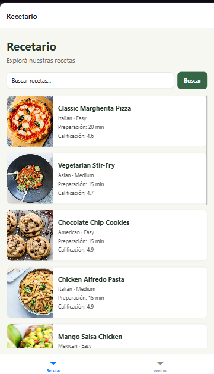
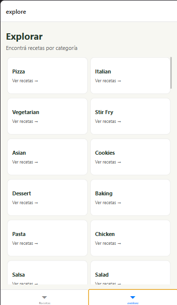
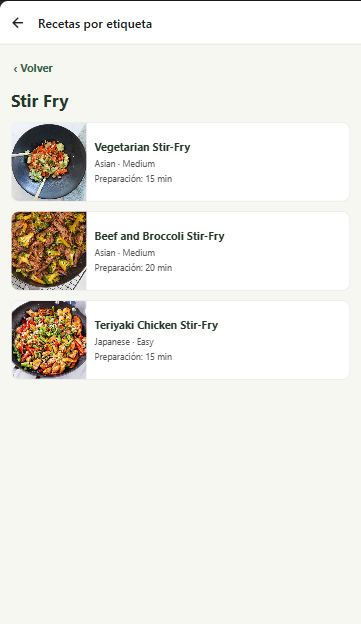
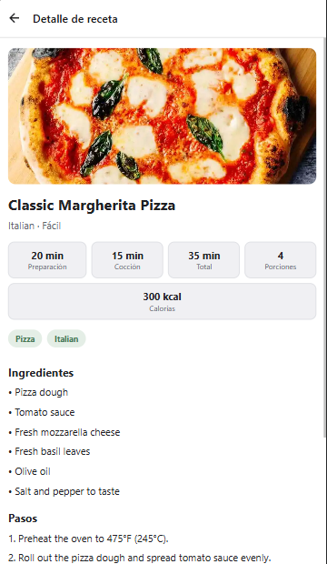
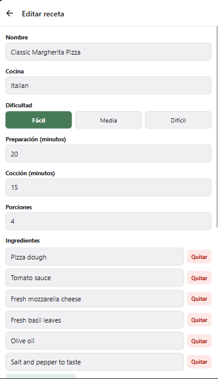

# Recetario 🍲

Aplicación móvil desarrollada con **React Native, Expo, Expo Router y
TypeScript** para consultar, buscar, explorar y administrar recetas
utilizando la API pública de
[DummyJSON](https://dummyjson.com/docs/recipes).

## Integrantes

-   **\[Galvan Ian\]**
-   **\[Franzoy Facundoo\]**
-   **\[Hernandez Sergio\]**

## Propuesta elegida

**Trabajo Práctico Final --- Unidad 5, Propuesta 2: Recetario.**

La aplicación permite consultar recetas, buscar por nombre, explorar
etiquetas, ver el detalle de una receta y crear, editar o eliminar
recetas durante la sesión.

## Tecnologías

-   React Native
-   Expo
-   Expo Router
-   TypeScript
-   React Context para compartir el estado de las recetas entre
    pantallas
-   DummyJSON Recipes API

No se necesita una API key para consumir DummyJSON.

## Requisitos previos

-   Node.js y npm instalados.
-   Expo Go instalado en el celular, o un emulador configurado.
-   Conexión a Internet para consultar DummyJSON.

## Cómo ejecutar el proyecto

1.  Clonar el repositorio:

    ``` bash
    git clone https://github.com/shernandezudi/Recetario.git
    ```

2.  Entrar en la carpeta:

    ``` bash
    cd Recetario
    ```

3.  Instalar las dependencias:

    ``` bash
    npm install
    ```

4.  Iniciar Expo:

    ``` bash
    npx expo start
    ```

5.  Escanear el código QR con Expo Go o abrir el proyecto en un emulador
    compatible.

Para comprobar los tipos de TypeScript:

``` bash
npx tsc --noEmit
```

## Funcionalidades

### 1. Recetas

-   Lista recetas con imagen, nombre, dificultad y tiempo.
-   Permite buscar recetas por nombre consultando la API.
-   Permite cargar más resultados mediante paginación.
-   Ofrece acceso al formulario para crear una receta.

### 2. Explorar etiquetas

-   Consulta las etiquetas disponibles en DummyJSON.
-   Presenta las etiquetas para que el usuario elija una.

### 3. Recetas por etiqueta

-   Muestra las recetas que pertenecen a la etiqueta seleccionada.
-   Permite entrar al detalle de cada receta.

### 4. Detalle de receta

-   Muestra información de la receta, como cocina, dificultad, tiempos,
    porciones, calorías, ingredientes y pasos.
-   Permite navegar a la edición y solicitar la eliminación.
-   Permite explorar las etiquetas asociadas a la receta.

### 5. Alta y edición

-   Utiliza un formulario compartido para crear y editar recetas.
-   Incluye campos para nombre, cocina, dificultad, tiempos y porciones.
-   Permite agregar, editar y quitar ingredientes y pasos.
-   Valida los campos antes de guardar y muestra mensajes de error o
    confirmación.

## Estructura del proyecto

``` text
Recetario/
├── app.json
├── package.json
├── src/
│   ├── app/
│   │   ├── (tabs)/
│   │   │   ├── _layout.tsx
│   │   │   ├── index.tsx
│   │   │   └── explore.tsx
│   │   ├── etiqueta/
│   │   │   └── [tag].tsx
│   │   ├── receta/
│   │   │   ├── [id].tsx
│   │   │   ├── nueva.tsx
│   │   │   └── editar/
│   │   │       └── [id].tsx
│   │   ├── _layout.tsx
│   │   └── ...
│   ├── components/
│   ├── constants/
│   ├── context/
│   └── hooks/
├── services/
│   └── recetas.ts
├── types/
│   └── receta.ts
└── utils/
    └── formato.ts
```

-   `src/app/`: pantallas y navegación con Expo Router. Las rutas
    dinámicas reciben parámetros como el ID o la etiqueta.
-   `src/components/`: componentes reutilizables de interfaz y
    formularios.
-   `src/constants/`: constantes compartidas, incluidos los colores.
-   `src/context/`: estado compartido de las recetas para mantener los
    cambios visibles entre pantallas durante la sesión.
-   `src/hooks/`: hooks propios para reutilizar lógica.
-   `services/`: funciones que consultan la API; las pantallas no
    deberían llamar a `fetch` directamente.
-   `types/`: tipos TypeScript para las recetas y los datos de entrada.
-   `utils/`: funciones auxiliares, por ejemplo, cálculo del tiempo
    total y traducción de dificultad.

## API utilizada

Base URL: `https://dummyjson.com`

  Método        Endpoint                     Uso
  ------------- ---------------------------- -----------------------
  GET           `/recipes?limit=10&skip=0`   Listado paginado
  GET           `/recipes/search?q=texto`    Búsqueda por nombre
  GET           `/recipes/{id}`              Detalle
  GET           `/recipes/tags`              Lista de etiquetas
  GET           `/recipes/tag/{tag}`         Recetas por etiqueta
  POST          `/recipes/add`               Simular creación
  PUT o PATCH   `/recipes/{id}`              Simular actualización
  DELETE        `/recipes/{id}`              Simular eliminación

**Importante:** DummyJSON simula las operaciones de escritura. Las
recetas creadas, editadas o eliminadas no se guardan de forma permanente
en el servidor. Por eso, la aplicación utiliza estado compartido en el
cliente para reflejar esos cambios durante la sesión. Las recetas
creadas localmente no existen en el servidor y deben resolverse desde
ese estado.

## Capturas de pantalla

``` md





```

## Uso de inteligencia artificial

Se utilizó ChatGPT como apoyo para revisar tipos TypeScript, imports,
integración entre pantallas y servicios, y manejo del estado de las
recetas.

### Prompts importantes utilizados

1.  "Revisá los tipos de TypeScript para la entidad Receta y los datos
    necesarios para crear y editar una receta con DummyJSON."
2.  "Ayudame a organizar una capa de servicios para listar, buscar,
    obtener, crear, actualizar y eliminar recetas usando DummyJSON."
3.  "Revisá el Context de React para que las recetas creadas, editadas y
    eliminadas se reflejen entre pantallas aunque DummyJSON no persista
    las escrituras."
4.  "Ayudame a corregir los imports relativos de servicios, tipos y
    utilidades en un proyecto Expo con carpetas dentro de `src/` y
    carpetas de soporte en la raíz."
5.  "Revisá el formulario de receta para validar los campos y manejar
    ingredientes y pasos como listas dinámicas."

### Ejemplos de propuestas incorrectas o que necesitaron corrección

-   **Tipos de alta demasiado amplios:** inicialmente se intentó usar el
    tipo completo `NuevaReceta` para los datos que entrega el
    formulario. El formulario no solicita todos los campos de DummyJSON,
    como calorías, etiquetas, tipo de comida e imagen. Se ajustó el tipo
    de datos del formulario y se completaron los campos faltantes antes
    de llamar al servicio de creación.
-   **Imports relativos incorrectos:** algunos imports apuntaban a
    `services/`, `types/` o `utils/` con una cantidad incorrecta de
    `../`. Se revisaron las ubicaciones de los archivos y se corrigieron
    las rutas para que TypeScript pudiera resolverlos.
-   **Persistencia asumida en la API:** una escritura exitosa en
    DummyJSON no significa que los datos queden guardados
    permanentemente. Se contempló el estado local compartido para que
    las recetas nuevas y sus cambios se mantengan visibles durante la
    sesión.

## Repositorio

[GitHub --- Recetario](https://github.com/shernandezudi/Recetario)
